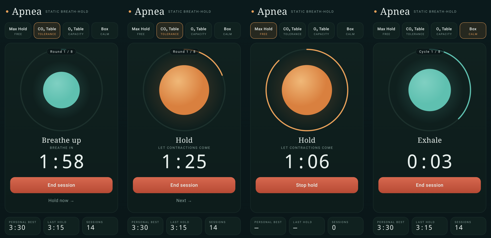

# Apnea (Android)

A dark-themed Android port of [ian-flores/apnea-trainer](https://github.com/ian-flores/apnea-trainer),
a dry static breath-hold trainer. Kotlin + Jetpack Compose, no network permission, all data stays on the device.



## Features

- **Max Hold**: optional 40 s guided breathe-up, a 4 s final breath, then an open-ended count-up hold. *Stop hold* banks the time and updates your personal best.
- **CO₂ table**: 8 rounds, hold fixed at ~50 % of your best, recovery 2:00 shrinking 15 s per round (min 0:15).
- **O₂ table**: 8 rounds, recovery fixed at 2:00, holds rising from ~40 % to ~85 % of your best.
- **Box breathing**: 8 cycles of 4-4-4-4.
- Breathing orb and progress ring, *Hold now → / Skip → / Next →*, a session-plan preview, stats (best, last, sessions) and history.
- Tone cues (same pitches as the web app) plus **vibration cues**, so you can train eyes-closed. The screen stays on during a session.

The max-hold setting and your personal best are the same number, as in the original: tables are always sized from your best.

## Build and install

```sh
just build     # nix-shell: JDK 17, Gradle, Android SDK 36 → app/build/outputs/apk/debug/app-debug.apk
just test      # unit tests (a port of the original test.js, plus session-engine tests)
just install   # adb install + launch on the USB-connected phone
```

The dev build installs side by side with any release build as **Apnea Dev** (`dev.apnea.trainer.dev`).
It's signed with the checked-in `keystore/dev.keystore` (password `android`), so APKs built on different
machines can upgrade each other in place.

⚠️ **Dry static only.** Never hold your breath in or near water without a trained buddy. This is not medical advice.
